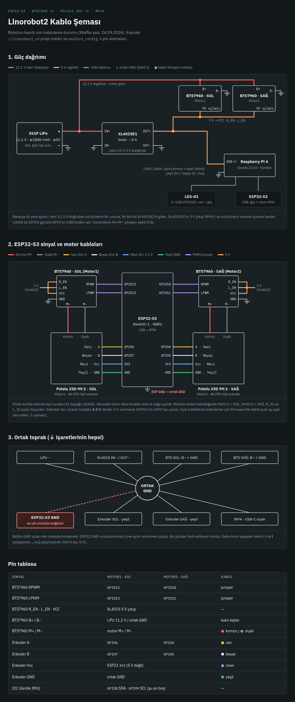

# custom_turtlebot

ESP32-S3 ve Raspberry Pi 4 üzerine, [linorobot2](https://github.com/linorobot/linorobot2) /
[linorobot2_hardware](https://github.com/linorobot/linorobot2_hardware) açık kaynak ekosistemiyle
inşa edilmiş, özel (custom) mekanik parçalara sahip bir diferansiyel sürüşlü mobil robot.

## Kablolama Şeması

(Etkileşimli/canlı hâli: [kablo_semasi.html](kablo_semasi.html) — indirip tarayıcıda açın.)

## İçindekiler

- `index.html` — tam yapım kılavuzu: malzeme listesi, güç mimarisi, kablolama şeması, yazılım
  kurulumu, kalibrasyon, joystick teleop, systemd otomatik başlatma, SLAM/Nav2 ve bilinen sorunlar
  (tarayıcıda açılabilir)
- `kablo_semasi.html` (+ `kablo_semasi.png` statik görseli) — `index.html` §04'teki şemayı tamamlayan,
  ayrı figürlere bölünmüş detaylı kablolama referansı (güç / sinyal+motor / ortak toprak)
- `TurtleBot_Yapim_Kilavuzu.pdf` — `index.html`'in tam PDF hâli (33 sayfa, aynı içerik — tek dosya olarak
  paylaşmak/yazdırmak için)
- `esp32s3_config.h` — bu robotta fiilen kullanılan, kalibre edilmiş ESP32-S3 yapılandırma dosyası
- `install_linorobot2.bash` — Raspberry Pi 4 kurulum betiği (proje notuyla)
- `urdf/2wd_properties.urdf.xacro` — gerçek mezura ölçüleriyle güncellenmiş URDF özellik dosyası
- `config/ekf.yaml`, `config/navigation.yaml` — bu robotta kullanılan gerçek EKF/Nav2 parametreleri,
  upstream'den farkları `index.html` §13'te listeli
- `systemd/` — temel sistem ve joystick'in otomatik başlatılması için 3 servis dosyası +
  `install_agent_service.sh` (bringup servisini kuran gerçek betik)
- `scripts/` — `start_robot.sh` (SLAM/Nav2 başlatma), `dpad_teleop.py` (joystick), `go_1m_test.py`
  (kalibrasyon testi), `joint_track.py`/`odom_track.py` (kalibrasyonda fiilen kullanılan ölçüm
  araçları), `baud_scan.py` (LIDAR baud teşhis aracı, tarihsel)

## Durum

Robot, Waffle tarzı 4 katlı bir şasi üzerine kurulu, diferansiyel sürüşlü. Encoder/tekerlek kalibrasyonu
gerçek mezura ölçümleriyle yapıldı (bkz. §08). LIDAR olarak ROBOTIS LDS-01 (`hls_lfcd_lds_driver`)
kullanılıyor. Joystick teleop ve sistemin systemd ile otomatik başlatılması tam olarak çalışıyor.
SLAM/Nav2 ile haritalama ve otonom navigasyon test edildi. Şaft-adaptör mekanik toleransı hassas bir
nokta — bkz. `index.html` §05 ve §10.

## Devam Eden Araştırma

Bu platform, WiFi kapsama alanı haritalaması üzerine yürütülecek bir araştırma projesinin temelini
oluşturmaktadır. Bu platform otonom hareket, haritalama (SLAM) ve navigasyon (Nav2) işlevlerini
içermektedir; WiFi sinyal ölçümünün robotun konum bilgisiyle eşleştirilmesi, konum-etiketli
kapsama haritası üretimi ve gerçek bir endüstriyel sahada manuel ölçümle doğrulanması bu temel
üzerine geliştirilecek ve ayrı bir çalışma kapsamında ele alınacaktır.
